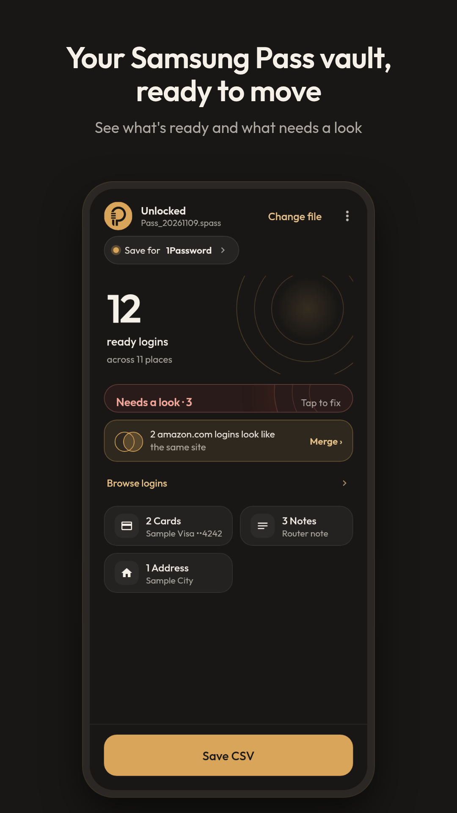
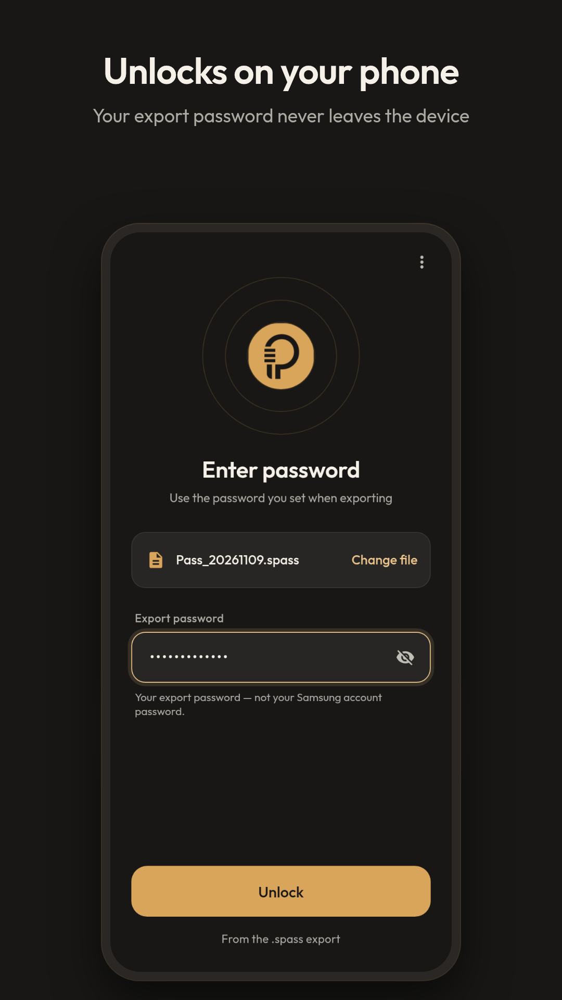
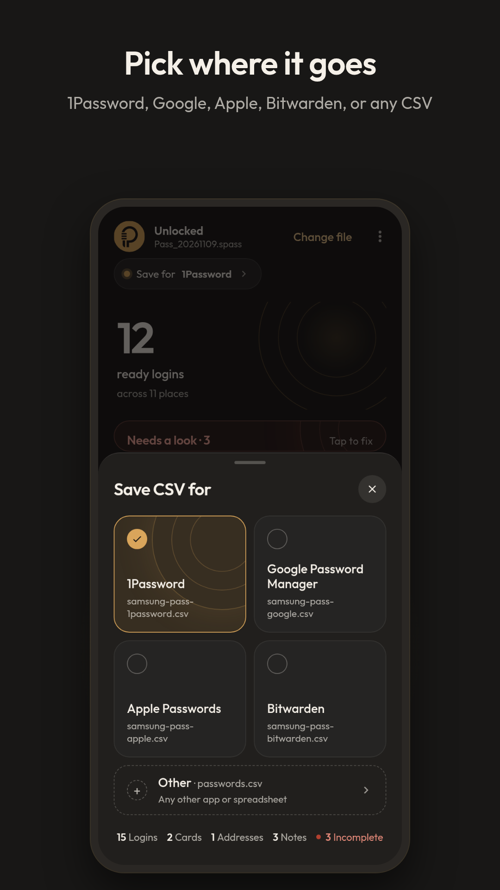
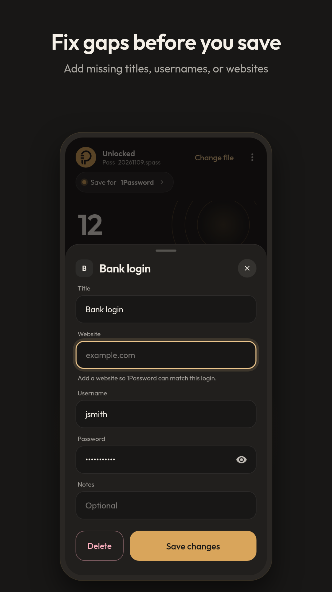
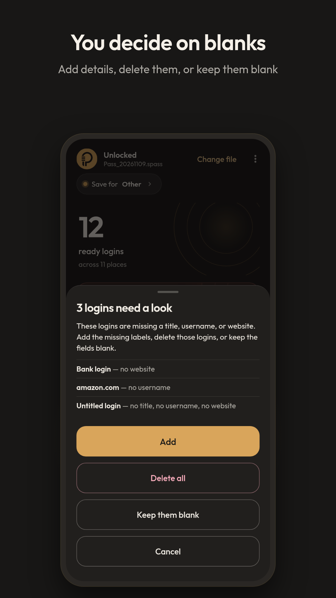

# Spcc


**Spass to CSV Converter.** Convert a Samsung Pass `.spass` export into a CSV for 1Password, Google Password Manager, Apple Passwords, Bitwarden, or any other password manager. Everything happens on your phone. Nothing is uploaded. No accounts, analytics, or telemetry.

Not affiliated with Samsung.

## Get it

- **Android app:** [Google Play](https://play.google.com/store/apps/details?id=com.jrrahman.passtocsv) — **$2.99 one-time**, yours for life, no subscription, no ads, no in-app purchases. Installed from Play, the app shows Play's in-app update prompt (Play downloads and installs; the app contacts Google Play only for this). Conversion stays on-device; the WebView has no network.
- **Developers:** this repository is the full source code under the [MIT License](LICENSE). Build it yourself (see **Develop**). No prebuilt APK/AAB files are published here.

## Screenshots

    

## Use it

1. In Samsung Pass: Settings → Export data. Set an export password and save the `.spass` file.
2. Open Spcc and choose the file.
3. Type the **export** password (not your Samsung account password) and tap **Unlock**.
4. Tap **Save for** and pick 1Password, Google Password Manager, Apple Passwords, Bitwarden, or Other (a generic `passwords.csv`).
5. The vault shows how many logins are ready and across how many places — not the full list up front.
   - **Needs a look** — tap to add a missing title, username, or website. The app never guesses websites, and it never overwrites a real website from your export.
   - **Browse logins** — search and edit ready logins, grouped by website.
   - If two logins share the same website (or app) **and** the same username, a merge suggestion appears. You pick which fields to keep.
   - Addresses, cards, and notes open from tiles. You can preview them, save a separate CSV, or delete an item (with undo). Bitwarden notes stay in the main file.
6. Tap **Save CSV** and confirm. A step-by-step guide for your password manager appears — follow it to import.
   - When saving to **Other**, missing titles, usernames, or websites warn first. You can **Add** the missing labels, **Delete all** those incomplete logins, or **Keep them blank** (empty CSV cells — no placeholders).
7. **Delete the CSV** and the `.spass` file after importing. The CSV holds your passwords in plain text.

To start over with a different export, tap **Change file**. Leaving the app also clears unlocked data from memory.

## Develop

```bash
npm ci
npm test          # vitest: crypto round-trip, parser, golden CSVs, UI
npm run build     # writes index.html, app.js, samsung-pass-to-csv.html, android/app/src/main/assets/
npm run check     # fails if generated files drift or Android policy is violated
gradle -p android assembleRelease   # signed APK; needs JDK 17 + Android SDK 36 and android/keystore.properties
gradle -p android bundleRelease     # signed Play AAB (same signing setup)
```

Sources live in `web/src` (TypeScript) and `android/` (Kotlin). Never edit the generated root files by hand.

The launcher icon is an adaptive vector (`android/app/src/main/res/mipmap-anydpi-v26/ic_launcher.xml`): brass P-ring foreground (`drawable/ic_launcher_foreground.xml`), Ember Charcoal `#181716` background, and a monochrome layer for themed icons. Play listing art lives in `docs/play/art/` (see `docs/play/listing.md`).

Build output (`*.apk`, `*.aab`, `dist/`) is gitignored. Signing keys stay local in `android/keystore.properties` (also gitignored).

## License

[MIT](LICENSE) © 2026 Juel Hossain. The Play Store build is the paid, signed distribution; the source is free to read, build, and modify.
